# Aurora Home

A home screen (launcher) for Android TV and Google TV, built for a 1080p TV and a D-pad remote. Each look is a complete home screen with its own layout, sounds and games, not a recolour.

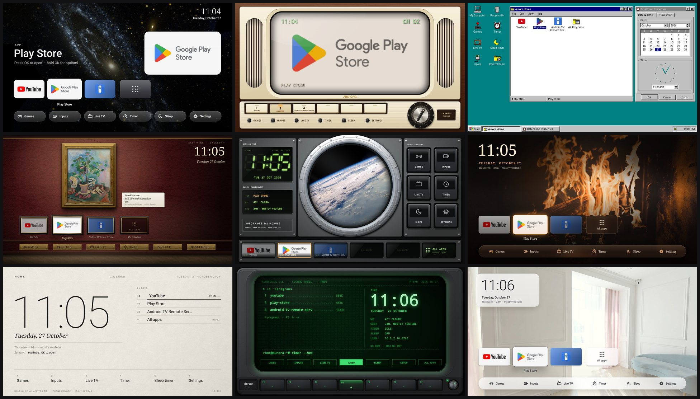

**New here? → [Setup guide](SETUP.md)** takes a TV from the box to Aurora in about 15 minutes.

## The looks

| | |
|---|---|
| 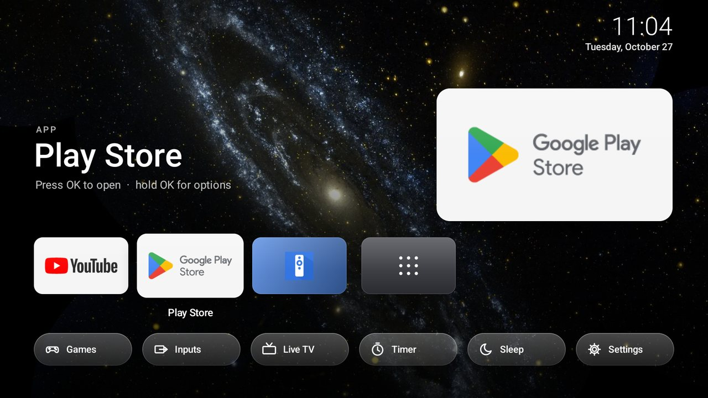 **Aurora**: an Apple TV-style home with full-bleed photos, icons that lift toward you, and glass buttons | 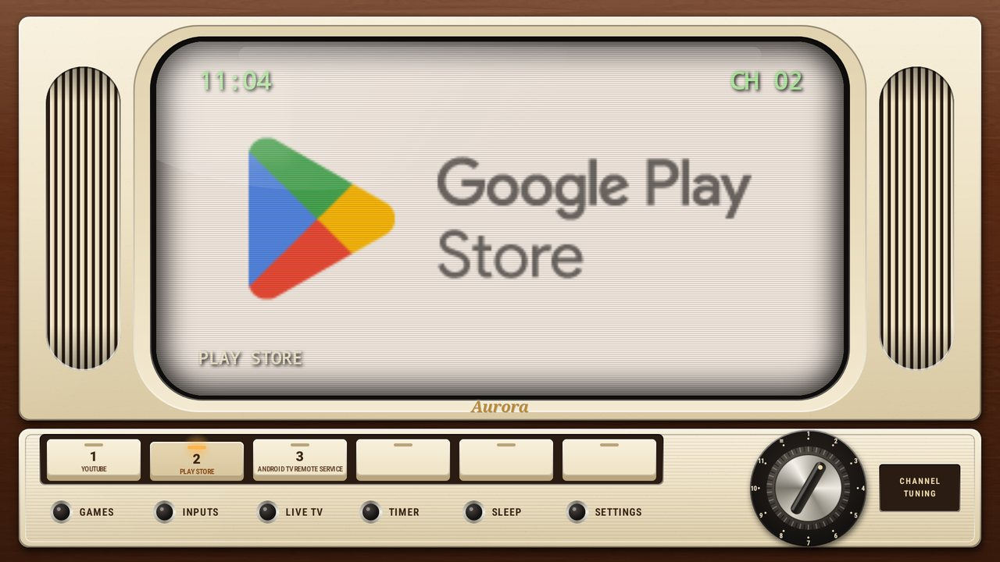 **Retro**: the whole screen is a 1960s Japanese TV, with piano-key channel presets and a chrome tuning dial |
| 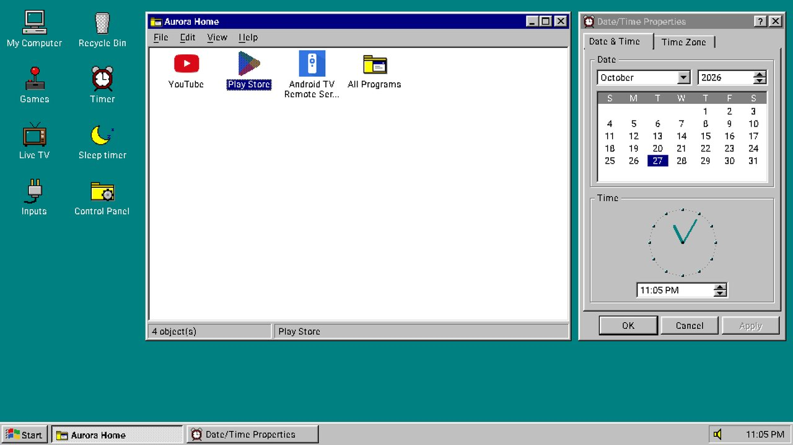 **Classic**: a Windows 95 desktop, drawn pixel for pixel | 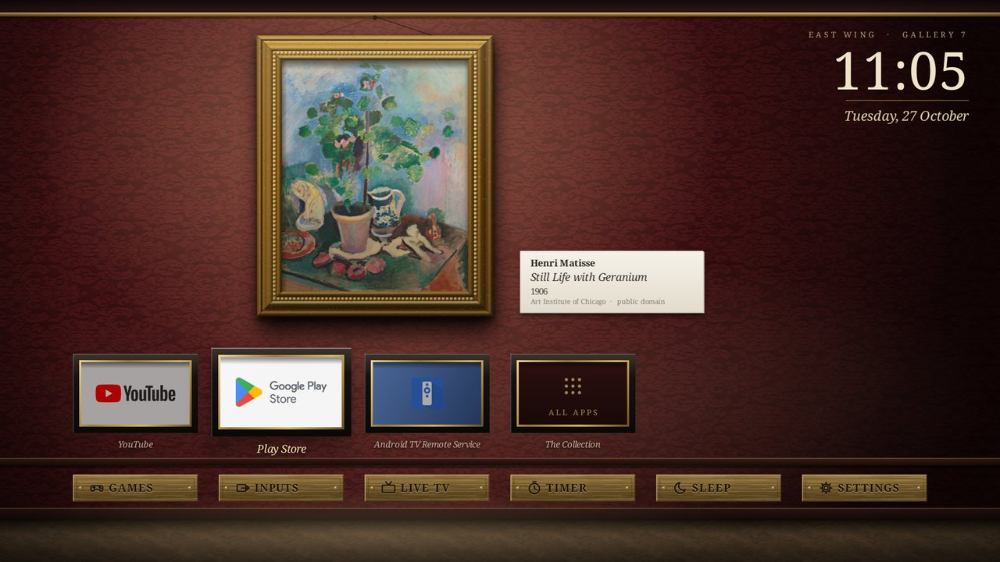 **Art**: a famous painting in a gilded frame, with a museum label |
| 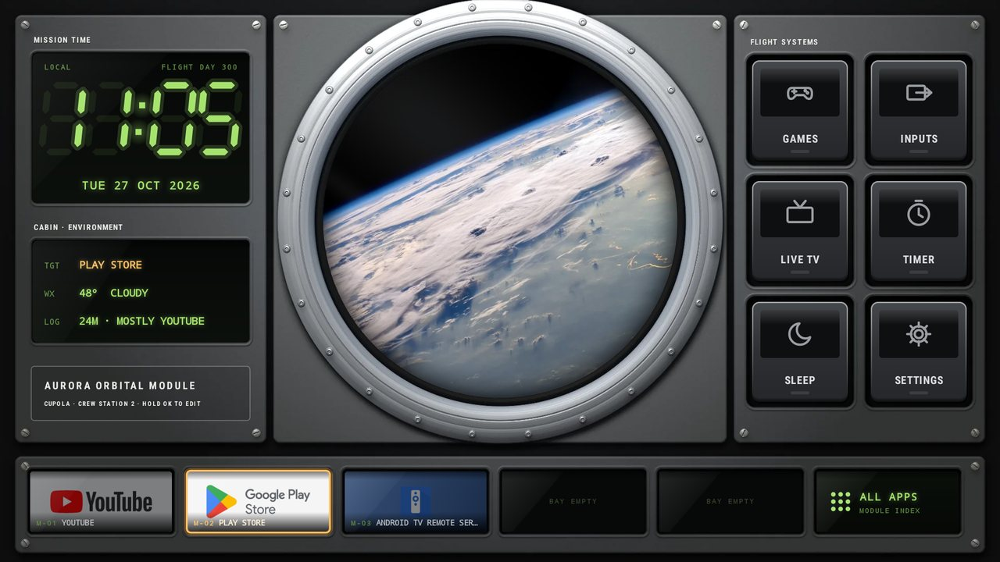 **Space**: a porthole onto Earth, with backlit flight-system buttons | 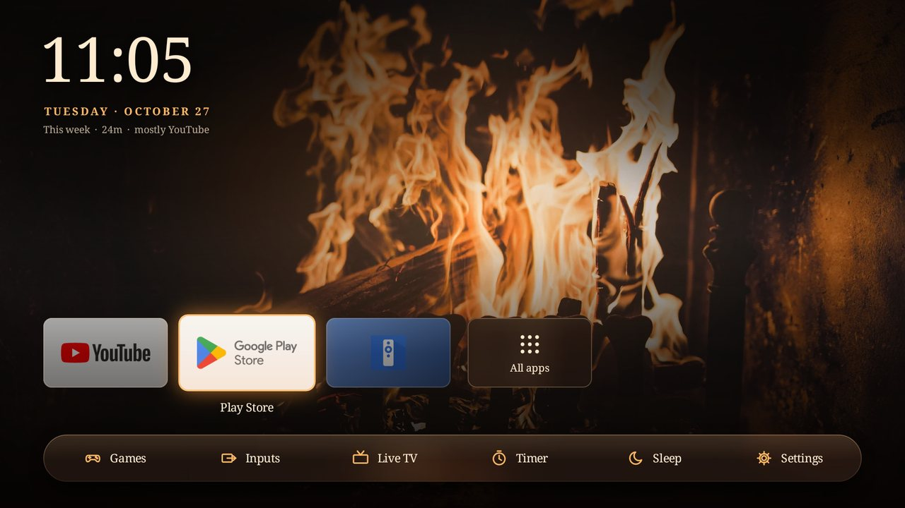 **Cozy**: an open fire with a gentle flicker |
| 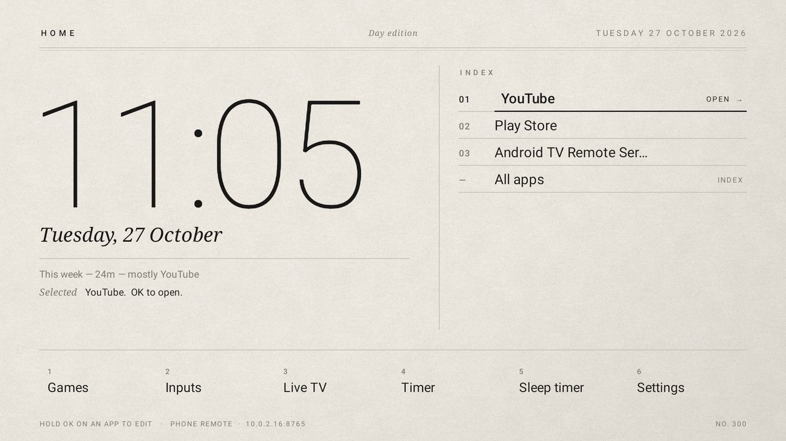 **Minimal**: paper and ink by day, black stock at night | 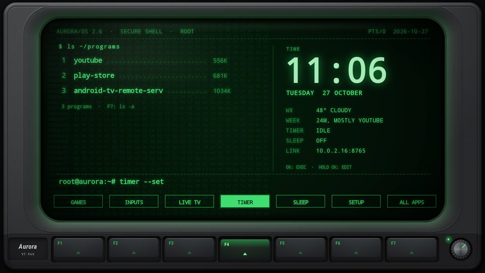 **Computer Science**: a green phosphor hacker terminal |
| 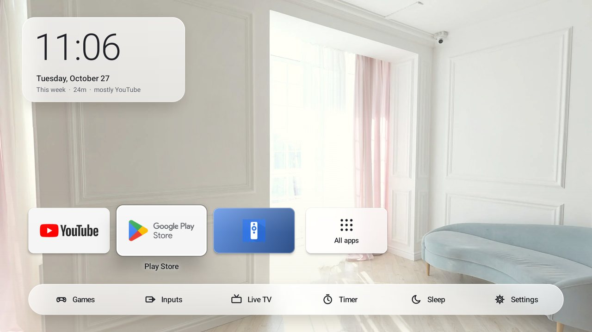 **Day & Night**: a sunny room by day, the fire after 7 pm | |

Every look has its own sound set: a tuner clicking into place in Retro, a mechanical keyboard in Computer Science, and so on. The volume is adjustable.

## Games that match the look

Nine built-in games: Tic-Tac-Toe, Connect 4, Checkers, Chess, Dots & Boxes, Hangman, 2048, Minesweeper and Solitaire. You can play against the computer, pass the remote, or go solo. Each game is drawn in the current look:

- **Classic:** Windows 95 games.
- **Computer Science:** ASCII.
- **Space:** console displays.
- **Retro:** a 70s game set.
- **Art:** ivory and gilt.

Here they are in Classic:

| | | |
|---|---|---|
| 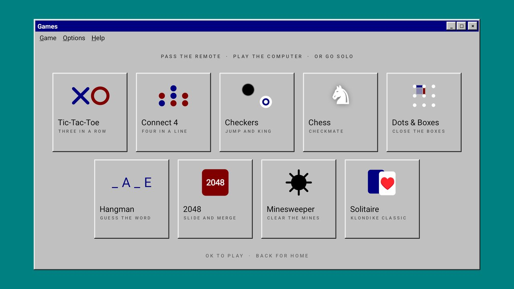 | 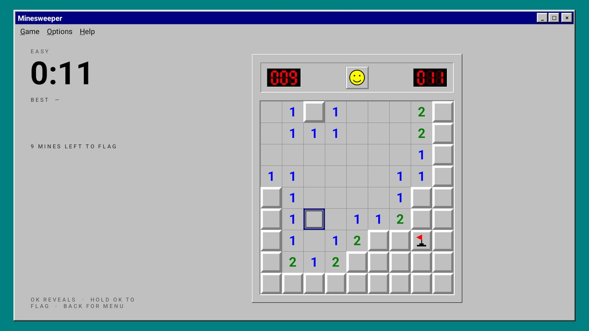 | 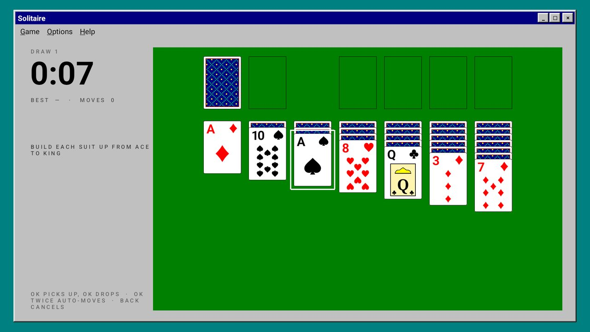 |
| 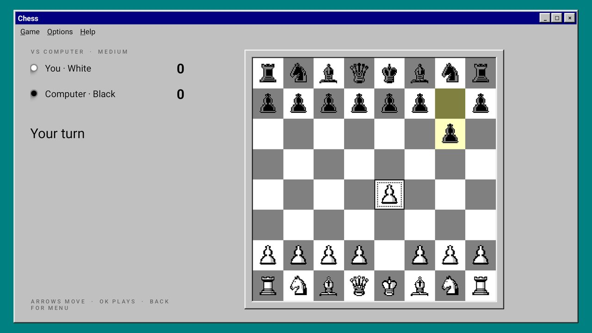 | 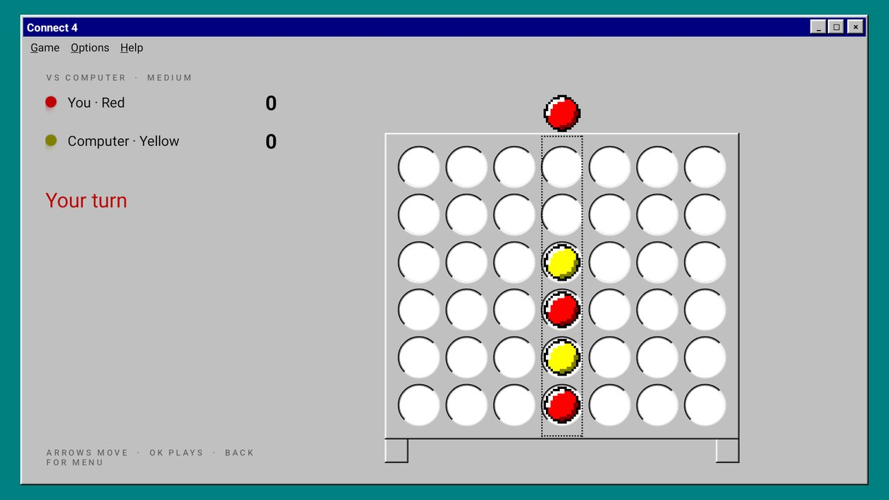 | 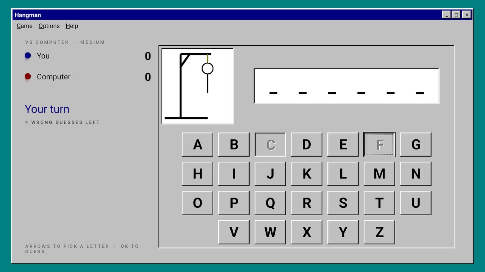 |

## Phone remote

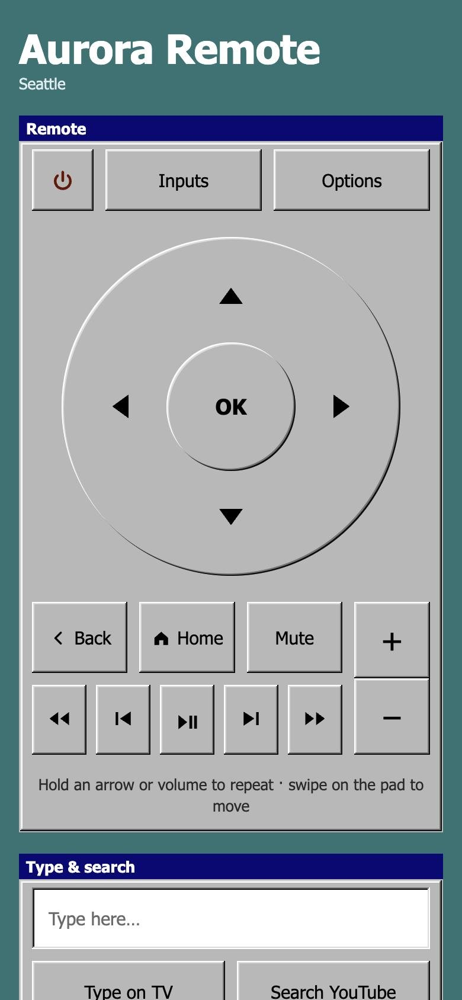 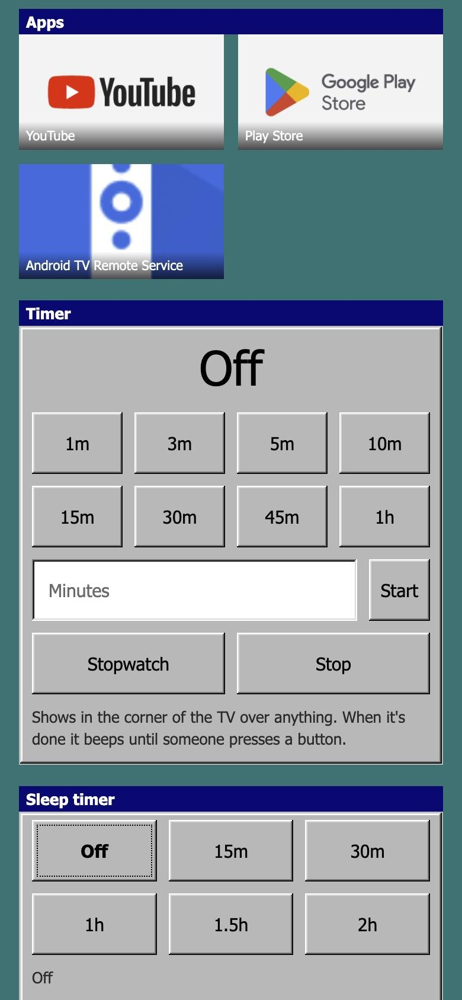

Open it in your phone's browser, pair it with a one-time code, and add it to your home screen. It has:

- a D-pad you can hold or swipe;
- volume, typing and search;
- your apps, the timers and the sleep timer;
- night mode, settings backup, and more.

It takes on the TV's current look. With **Arrows in every app** turned on, the arrows also work inside YouTube and Netflix. See the [setup guide](SETUP.md#7-use-your-phone-as-a-remote).

## Other features

- **Sleep timer, bedtime and wind-down**, which slowly lowers the volume and dims the screen.
- **Night mode**, which warms and dims the screen late at night.
- **Morning screen** with the weather and your calendar.
- **Kid lock**, a **Settings PIN** and a **security panel** that warns about risky settings and lists paired phones.
- **Gentle volume:** holding volume changes it at a steady pace instead of racing.
- **Settings backup and restore** from the phone.
- A **screensaver** of the wallpapers or famous paintings.

## Building

You need JDK 17 and the Android SDK, with `local.properties` pointing at it (Android Studio creates that file). Then:

```bash
./build.sh            # AuroraHome.apk (release)
./build.sh --preview  # AuroraHome-preview.apk (debuggable, for an emulator)
./build.sh --test     # unit tests
```

Installing it on a TV is covered in the [setup guide](SETUP.md).

**Signing.** Without a `keystore.properties`, builds use Android's debug key. To sign with your own key, create `keystore.properties` next to `build.gradle.kts`. Git ignores it. Keep the key backed up, because the TV only accepts updates signed with the same key. The file looks like this:

```properties
storeFile=your.keystore
storePassword=…
keyAlias=…
keyPassword=…
```

**Aurora wallpapers.** The original build uses macOS wallpapers. Those belong to Apple and aren't in this repository, so the Aurora look uses NASA photos instead (as in the screenshots). To use your own, add them as `res/drawable-nodpi/wp_<name>.webp` with a blurred copy named `wp_<name>_blur.webp`.

## Credits

Every picture in this repository is public domain, CC0, or drawn for this project.

| Files | Source | Licence |
|---|---|---|
| `sp_*.webp`, `space_earth.webp` | NASA (Hubble and Webb images with ESA, CSA and STScI). `space_earth` is the ISS Expedition 20 photo "Thunderstorms on the Brazilian Horizon" | NASA public domain |
| `cozy_fire.webp` | "Fire in the Winter" by Sweet Ice Cream Photography, via [Wikimedia Commons](https://commons.wikimedia.org/wiki/File:Fire_in_the_Winter_(Unsplash).jpg) | CC0 |
| `light_room.webp` | [Poly Haven](https://polyhaven.com/a/brown_photostudio_05) HDRI "brown_photostudio_05" | CC0 |
| `tx_walnut.webp` | Poly Haven texture [walnut_veneer](https://polyhaven.com/a/walnut_veneer) | CC0 |
| `art_damask.webp`, `art_parquet.webp` | Poly Haven textures [floral_jacquard](https://polyhaven.com/a/floral_jacquard) and [herringbone_parquet](https://polyhaven.com/a/herringbone_parquet) | CC0 |
| `cs_bezel.webp`, `space_cabin.webp`, `minimal_paper.webp` | Rendered for this project | — |
| `res/raw/*.wav` | Synthesized by `tools/sounds.py` and `sounds.py` | — |
| Paintings in the Art look and screensaver | Downloaded at runtime from the [Art Institute of Chicago API](https://api.artic.edu/docs/) (public-domain works only) | CC0 |
| `docs/screenshots/*` | Screenshots of this app | — |
